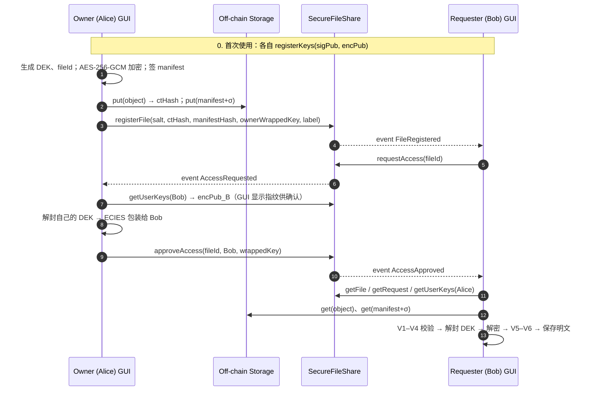

# CSIT953 Assignment 2 — Secure File Sharing System 技术方案

> 中文备份：2026-10-18 改成英文之前的 DESIGN.md。英文版见 [DESIGN.md](DESIGN.md)。

> 截止：2026-10-28（周三）23:30 · 小组作业（≤5 人）· 总分 30（实现+报告 26，Demo 4）
> 资料依据：`task_requirement.md`、Lab 1–4、Week 2–11 slides。表中「课程」一栏写明出处，报告里可直接引用。

---

## 0. 一页摘要

**一句话方案**：客户端先用 AES-256-GCM 加密文件、用 ECDSA(secp256k1) 签名，密文放进不可信的链下存储；
智能合约登记文件、管理「申请 → 批准/拒绝 → 撤销」状态机，并强制只有文件 owner 能审批；
批准时 owner 用 ECIES 把文件密钥 DEK 加密给申请人，密文直接存在合约里。

| 层 | 选型 | 理由 | 课程 |
|---|---|---|---|
| 语言 | Python 3.11+ | Lab 1/3/4 都是 Python，组员熟悉 | Lab 1/3/4 |
| 合约 | Solidity ^0.8.24 | Lab 2 用过；0.8 自带溢出检查 | Lab 2, W3 |
| 区块链 | 开发和自动化测试用 **Anvil 本地链**；最终版部署到 **Sepolia**，在上面取证和 Demo，本地链备用（见 5.1） | 本地链秒级出块、可复现；Sepolia 有 Etherscan 公开记录，老师可以自己核对 | Lab 1/2 |
| 合约编译/测试 | Foundry（`forge build` / `forge test`，含 fuzz） | `vm.prank` + `vm.expectRevert` 写未授权测试很直接 | W10 fuzzing |
| 链交互 | web3.py 7.x + eth-account | Lab 1 同款 | Lab 1 |
| 密码库 | **pyca/cryptography**（OpenSSL 后端） | AES-GCM、HKDF、ECDSA/ECDH secp256k1、scrypt 全有；底层是广泛审计的 OpenSSL | 替代 Lab 的 py_ecc |
| 链下存储 | 本地目录模拟不可信云对象存储，按密文 SHA-256 内容寻址；两台电脑演示时可加一个 HTTP 存储服务（见 2.2） | 任务书允许；内容寻址自带完整性锚点 | W4 object storage |
| GUI | Tkinter/ttk 桌面应用（复用 quiz2/quiz3 的 theme 和线程模式，兼容性见 8.1） | 零额外依赖，组员写过 | Lab 3 GUI |
| 测试 | pytest、forge test、Slither、Bandit、Gitleaks | 覆盖功能、未授权、静态分析、密钥泄露扫描 | W9, W10 |

**六个关键决定**（报告里每条都要写「为什么」）：

1. **信封加密**：每个文件一把随机 DEK，DEK 再按接收人分别包装（per-recipient wrapping）。（W4 envelope encryption）
2. **AEAD 而非 CTR**：Lab 4 的 CTR 每条消息都从同一计数器开始，密钥流重复且没有完整性；改用 AES-256-GCM + 随机 nonce + AAD 绑定上下文。
3. **每个用户三把密钥，用途分离**：交易账户密钥、签名密钥、加密密钥。签名私钥不能顺带签交易。
4. **公钥登记上链**：地址 → 公钥的绑定由持有该地址的人发交易写入，解决 W7 的 public key substitution 和 W6 的 DH 中间人问题。
5. **ECIES 做密钥分发**：非交互（申请人可以离线）、每次包装用临时密钥、HKDF 绑定 fileId 和 requester，防止把一份 wrappedKey 挪到别处用。
6. **链上最小化**：链上只放随机 fileId、哈希、公钥、密文形式的 wrappedKey 和状态；文件名、明文哈希、DEK 都不上链。

---

## 1. 评分项 → 设计 → 证据

| 评分项 | 分 | 本方案的做法 | 报告/Demo 证据 |
|---|---|---|---|
| File Encryption & Decryption | 4 | AES-256-GCM，每文件独立 DEK，随机 96-bit nonce，AAD 绑定 chainId/合约/fileId/owner；加密后才上传 | 存储目录里只有密文的截图；篡改 1 字节后 GCM 报错 |
| Digital Signatures | 2 | ECDSA-secp256k1-SHA256 签 manifest（含密文哈希 + 加盐明文摘要）；验签公钥从链上取 | 正常验签 ✓；改 manifest / 换密钥 / 改密文 ✗ |
| Blockchain & Smart Contract | 6 | `SecureFileShare` 合约：公钥登记、文件登记、请求状态机、owner 审批、撤销、事件审计 | forge 测试报告、Sepolia 交易表和 Etherscan 截图、事件日志、Slither 结果 |
| Secure Key Sharing | 3 | ECIES(secp256k1, HKDF-SHA256, AES-256-GCM)，93 字节 wrappedKey 存链上 | 申请人解封成功；第三方用自己的私钥解封失败；挪用失败 |
| GUI | 3 | Owner / Requester / Activity Log 三个页签，每一步有 ✓/✗ 反馈和交易回执 | 精选截图 4–6 张 |
| Security & Robustness | 4 | 威胁模型 + 16 项安全测试 + 静态分析 + 局限性讨论 | 安全测试矩阵（第 10 节） |
| Written Report | 4 | ≤20 页，按第 13 节分配篇幅 | — |
| Demonstration | 4 | 每人都能讲全流程、能现场改小功能 | 第 14 节准备清单 |

---

## 2. 系统架构

```
┌──────────────────────── 用户端（受信任）────────────────────────┐
│  Tkinter GUI  ──►  services（owner / requester 工作流）          │
│                     │            │              │               │
│                 crypto/       storage/        chain/            │
│        AES-GCM · ECDSA ·    对象存储客户端    web3.py 合约客户端  │
│        ECIES · keystore                                        │
│  keystore/<alias>.json（scrypt + AES-GCM 加密的三把私钥）        │
└─────────────┬──────────────────────────────┬───────────────────┘
              │ 密文对象 + 签名 manifest       │ 签名交易 / 读事件
              ▼                              ▼
   ┌───────────────────────┐      ┌───────────────────────────────┐
   │ 链下存储（不可信）       │      │ 区块链 Anvil / Sepolia         │
   │ objects/<ctHash>.bin  │      │ SecureFileShare 合约           │
   │ manifests/<fileId>.json│      │ 公钥登记 · 文件记录 · 请求状态   │
   └───────────────────────┘      │ wrappedKey · 审计事件           │
                                  └───────────────────────────────┘
```

- **信任边界**：只有用户自己的终端是受信任的。存储、网络、其他用户都按不可信处理；区块链只信它的完整性和顺序，不信它能保密。
- **分层**：`services` 不依赖 GUI，测试和 CLI 脚本可以直接调用；GUI 只做展示和线程调度。
- **任何用户都可以同时是 owner 和 requester**。Demo 时开两个 GUI 窗口，分别加载 Alice 和 Bob 的 keystore（和 quiz3 一样）。

### 2.1 什么上链、什么不上链

| 数据 | 位置 | 原因 |
|---|---|---|
| 用户签名公钥、加密公钥（各 33 字节压缩格式） | 链上 | 地址与公钥的权威绑定 |
| fileId（随机 32 字节）、owner 地址、登记时间 | 链上 | 状态机和审计需要 |
| ctHash = SHA-256(密文对象)、manifestHash | 链上 | 完整性锚点，防篡改和回滚 |
| 请求状态、时间戳 | 链上 | 审计和访问控制 |
| wrappedKey（DEK 的 ECIES 密文） | 链上 | 只有目标申请人能解开，公开也安全 |
| 可选公开标签 publicLabel（只写进事件） | 链上事件 | 方便申请人识别文件；GUI 提示「公开可见」，默认留空 |
| 明文、DEK、私钥 | **永不上链** | — |
| 文件名、MIME、明文摘要 | 链下，且文件名在密文里 | 避免元数据泄露和明文哈希被字典猜测 |
| 申请理由 | 不收集 | 数据最小化 |

**要在报告里写明的事实**：Solidity 的 `private` 变量、所有 calldata、所有事件对任何人都可读，链上记录也删不掉。所以 wrappedKey 的保密性完全靠 ECIES，合约的 `msg.sender` 检查只管授权，不管保密。

### 2.2 链下存储

**要不要**：文件不能上链，所以必须有链下存储；但不用搭真正的文件系统或云服务。任务书 2.1 明确允许 "local storage, simulated cloud storage"，本地目录就满足要求。威胁模型里把它当作不可信的云存储（攻击者 A1）。

**默认方案：本地目录模拟云对象存储**

```
storage/                          # STORAGE_DIR，所有 GUI 窗口指向同一个目录
├── objects/ab/ab3f…e9.bin        # 密文对象，文件名 = SHA-256(内容)，按前 2 位分子目录
└── manifests/0x7c…41.json        # 签名后的 manifest，文件名 = fileId
```

```python
class ObjectStore(Protocol):                       # app/storage/object_store.py
    def put_object(self, data: bytes) -> str: ...  # 返回 ctHash（hex）
    def get_object(self, ct_hash: str) -> bytes: ...
    def put_manifest(self, file_id: str, signed_manifest: bytes) -> None: ...
    def get_manifest(self, file_id: str) -> bytes: ...
```

- **内容寻址**：对象名就是密文的 SHA-256。链上的 ctHash 同时充当下载地址，链上不用存 URL 或路径；同样的内容写两次只存一份。
- 存储里只有密文对象和签名 manifest，没有密钥、明文和文件名。
- services 层对读回的数据重新算哈希（V1），不信任存储本身。
- 写入先写临时文件再 `os.replace`，避免留下半截文件。
- 拼路径前用正则校验 ctHash（64 位 hex）和 fileId（`0x` + 64 位 hex），防止 `../../keystore` 这类路径穿越。
- 设大小上限（如 50 MB），超出就拒绝并提示。
- GUI 的 Security demo 页（`SFS_DEMO=1`）直接改这个目录里的文件：翻转 1 个 bit、改 manifest、删除，再一键恢复。回滚到旧版本（S9）由 pytest 覆盖。

**Alice 和 Bob 在两台电脑上演示时（可选）**，本地目录共享不了，有两种办法：

1. `scripts/storage_server.py`：在一台电脑上跑 HTTP 存储服务（标准库 `http.server` 或 FastAPI，约 80 行），只提供 `PUT /objects`、`GET /objects/{ctHash}`、`PUT/GET /manifests/{fileId}`。客户端换成 `HttpObjectStore`，services 层不用改。这个服务同样不可信，只存密文。
2. 把 `STORAGE_DIR` 指向两台电脑都在同步的网盘目录（OneDrive/Dropbox/Google Drive）。不用写代码，正好对应任务书的 "public cloud services"；缺点是同步有几秒到几十秒延迟，Demo 时不好控制。

建议先只做本地目录，Demo 用一台电脑开两个窗口。正常流程跑通后还有时间，再加办法 1。IPFS 不建议做：要装节点或申请 pinning 服务的 API key，对评分帮助不大。

---

## 3. 威胁模型（报告 §3 的骨架）

**资产**：明文文件；DEK；每个用户的三把私钥和 keystore 密码；链上记录的完整性（谁拥有什么、谁被批准）；审计日志；元数据（谁向谁申请了什么）。

**攻击者能力**

| 编号 | 攻击者 | 能做什么 |
|---|---|---|
| A1 | 好奇或被攻破的存储方 | 读取、修改、删除、替换成旧版本密文和 manifest |
| A2 | 未授权的注册用户 | 发任意合约调用：批准别人的文件、批准自己的请求、重复申请；读取全部链上数据 |
| A3 | 网络/链上观察者 | 看到所有交易、calldata、事件；可以在公链上抢跑交易 |
| A4 | 公钥替换攻击者 | 在 owner 获取申请人公钥的路径上换成自己的公钥（W7） |
| A5 | 已被批准、之后被撤销的申请人 | 保留之前拿到的 DEK 和明文 |

**受信任组件**：用户终端和本程序客户端；cryptography/OpenSSL 的实现；操作系统 CSPRNG；区块链共识和顺序；经过测试的合约代码；本地 RPC 节点返回的数据（Sepolia 场景下要信任 RPC 提供方，列为局限）。

**安全假设**：secp256k1 上 ECDLP 困难；AES-256 和 GCM 安全；SHA-256 抗碰撞；用户保管好 keystore 密码；owner 对内容负责——签名证明「谁签的」，不证明内容真实（W3：区块链会忠实保存错误输入）。

**不在范围内**：终端中毒或被盗（W4：E2EE 不保护端点）；已授权用户主动外泄明文；存储方删除文件导致的可用性问题（能检测，不能阻止）。

**STRIDE → 控制措施**

| 威胁 | 控制 |
|---|---|
| Spoofing（冒充 owner 或替换公钥） | 公钥只能由地址持有人上链登记；验签公钥从链上读取；审批时合约检查 `msg.sender == owner` |
| Tampering（改密文、manifest、回滚） | 链上 ctHash/manifestHash + ECDSA 签名 + GCM tag + 加盐明文摘要 |
| Repudiation | 所有关键动作是签名交易并触发事件，不可抵赖 |
| Information disclosure | 客户端加密；DEK 只以 ECIES 密文出现；文件名在密文里；链上不放明文哈希 |
| Denial of service | 合约无循环、无外部调用；fileId 由 `msg.sender` 参与生成，抢跑无法占用别人的 fileId |
| Elevation of privilege | `onlyFileOwner` 修饰器；状态机拒绝非法跳转；合约没有 admin 和升级入口 |

---

## 4. 密码学设计

### 4.1 用户密钥体系

| 密钥 | 算法 | 用途 | 公钥去向 |
|---|---|---|---|
| `K_eth` | secp256k1（以太坊账户） | 只签交易、付 gas | 地址 |
| `K_sig` | ECDSA secp256k1 + SHA-256 | 只签文件 manifest | `registerKeys` 上链 |
| `K_enc` | secp256k1 ECDH | 只接收 ECIES 包装的 DEK | `registerKeys` 上链 |

**为什么分三把**：
- 用 `K_eth` 直接签任意 32 字节哈希很危险：同样的签名操作可能被诱导签下一笔交易，以太坊为此才有 EIP-191 前缀。分开以后，文件签名的泄露不影响资产和链上权限。
- `K_enc` 可以单独轮换（`registerKeys` 再调用一次），不用换账户地址。
- 三把密钥的暴露面不同，分开后单一泄露的影响范围更小（W4 key hierarchy、blast radius）。

**Keystore**（`keystore/<alias>.json`，已加入 `.gitignore`）：

```json
{ "version": 1, "address": "0x…",
  "kdf": { "name": "scrypt", "n": 131072, "r": 8, "p": 1, "salt": "<16B hex>" },
  "cipher": { "name": "AES-256-GCM", "nonce": "<12B hex>" },
  "ciphertext": "<GCM(密码派生密钥, {eth_sk, sig_sk, enc_sk})>" }
```

- 密码 → scrypt → 32 字节密钥 → AES-256-GCM。密码错误时 GCM 校验失败，统一提示「密码错误或文件损坏」，不区分原因。
- 私钥由 `secrets`/OpenSSL 生成。**不用 `random`**：Lab 3/4 的 `random.randint` 是 Mersenne Twister，输出可预测。
- 同一个 keystore 两条链通用：本地链上在 GUI 里点「Add 100 test ETH」（`anvil_setBalance`）给这些地址充值；Sepolia 上用水龙头领取或互相转账。Anvil 开发账户的私钥是公开的固定值，只用来部署合约，不放进用户 keystore。
- 没有做导入已有私钥的脚本（原计划的 `scripts/import_key.py`）。GUI 新建的 keystore 自带新地址，Sepolia 上从 Lab 1 或 MetaMask 账户给它转测试币即可，明文私钥不进本项目。

### 4.2 文件加密（AES-256-GCM）

```
DEK      = os.urandom(32)                                  # 每文件一把
salt32   = os.urandom(32)                                  # 生成 fileId 用
fileId   = keccak256(abi.encode(owner, salt32))            # 与合约算法一致
header   = canonical_json({name, mime, size, salt: os.urandom(16)})
P        = len(header) (4B, big-endian) ‖ header ‖ file_bytes
AAD      = "SFS-v1" ‖ chainId(32B) ‖ contract(20B) ‖ fileId(32B) ‖ owner(20B)
nonce    = os.urandom(12)
object   = "SFS1" ‖ nonce ‖ AESGCM(DEK).encrypt(nonce, P, AAD)   # 末尾含 16B tag
ctHash   = SHA-256(object)        → 存成 objects/<ctHash>.bin
```

- **为什么 GCM**：一次运算同时得到保密性和完整性，篡改任何字节都会在解密时报 `InvalidTag`。CTR 只加密不认证，攻击者翻转密文位就能定向改明文。
- **nonce**：每把 DEK 只加密一次，随机 nonce 不存在碰撞风险；即便以后支持多版本，也是换新 DEK。
- **AAD**：把密文绑定到「哪条链、哪个合约、哪个文件、哪个 owner」。存储方把 A 文件的密文换成 B 文件的，解密直接失败。
- **文件名放进 P**：存储方和链上观察者都看不到文件名；P 里的 16 字节随机盐让明文摘要无法被字典猜测（见 4.3）。
- **限制**：整个文件读入内存，适合 Demo 规模（<100 MB）；分块流式加密列为未来工作。

### 4.3 数字签名（ECDSA secp256k1）

签名对象是一份规范化 JSON（key 排序、无空白）：

```json
{ "schema": "sfs-manifest/1", "chainId": 31337, "contract": "0x…",
  "fileId": "0x…", "owner": "0x…",
  "ctHash": "<SHA-256(object)>", "ctSize": 12345,
  "ptDigest": "<SHA-256(P)>", "enc": "AES-256-GCM", "createdAt": 1760000000 }
```

```
σ = ECDSA_Sign(K_sig, SHA-256(manifest_bytes))        # (r, s)
manifests/<fileId>.json = { manifest, signature: {r, s} }   # 不存签名公钥
manifestHash = SHA-256(manifest_bytes)                → 上链
```

**申请人的验证顺序**（GUI 逐项打 ✓/✗）：

| 步骤 | 检查 | 能发现什么 |
|---|---|---|
| V1 | SHA-256(下载的 object) == 链上 ctHash | 存储方改密文、换成旧版本 |
| V2 | SHA-256(manifest) == 链上 manifestHash | 改 manifest |
| V3 | manifest 里的 fileId/owner/chainId/contract/ctHash 与链上一致 | 跨文件、跨链挪用 |
| V4 | ECDSA_Verify(**链上登记的** owner `sigPubKey`, manifest, σ) | 伪造签名、攻击者用自己的密钥重签 |
| — | 解封 DEK（第 6 节） | — |
| V5 | AES-GCM 解密，tag 通过 | 密文损坏、AAD 不匹配 |
| V6 | SHA-256(P) == manifest.ptDigest | 解出的内容就是 owner 签的那份；防 owner 给不同人不同密钥 |

全部通过才启用「保存明文」按钮。

**设计理由**：
- 签名同时覆盖密文哈希（解密前就能验证）和明文摘要（解密后确认内容），对应任务书「retrieved file corresponds to the data originally signed」。
- 签名公钥只从链上取，不信存储里附带的任何公钥——这就是 V4 能识别「攻击者重签」的原因。
- nonce k 按 RFC 6979 由私钥和消息确定性派生（cryptography 的 `deterministic_signing=True`），不依赖运行时随机数的质量（W3：nonce 重复或有偏差会泄露私钥）。
- ECDSA 签名可延展（(r, s) 与 (r, N−s) 都有效）。本系统不拿签名当标识符，所以没有影响；实现里签名统一成 low-s，验证也只接受 low-s。
- **和 Lab 3 的关联**：测试里用 py_ecc 按 Lab 3 的公式 `X = u1·G + u2·Q, r ≡ X.x mod N` 独立复验我们的签名。Demo 时如果被要求「手工验一个签名」可以直接用。

### 4.4 对 Lab 代码的改进清单（报告里很好用）

| Lab 里的做法 | 问题 | 本方案 |
|---|---|---|
| `random.randint` 生成私钥和 ECDSA nonce（Lab 3/4） | 非密码学随机数，可预测 → 私钥可被恢复 | 私钥用 OpenSSL CSPRNG 生成；ECDSA nonce 按 RFC 6979 确定性派生 |
| AES-CTR，`Counter.new(128)` 每次从同一起点（Lab 4） | 密钥流重复；没有完整性 | AES-256-GCM + 随机 nonce + AAD |
| `SHA-256(str(k))` 当会话密钥（Lab 4） | 没有 KDF、没有上下文绑定 | HKDF-SHA256，info 绑定 fileId/requester |
| 公钥直接通过 TCP 交换（Lab 4） | 中间人可替换公钥（W6） | 公钥由地址持有人上链登记 |
| `pickle.loads` 反序列化网络数据（Lab 4） | 任意代码执行 | 只用 JSON 和固定格式二进制 |
| 私钥明文写进 JSON 文件（Lab 1/3/4） | 文件泄露即私钥泄露 | scrypt + AES-GCM 加密的 keystore |
| py_ecc 纯 Python 点运算 | 非常数时间，有侧信道风险 | cryptography（OpenSSL）；py_ecc 只在测试里做交叉验证 |

---

## 5. 区块链与智能合约

### 5.1 网络部署方案（已定）

| 阶段 | 链 | 用途 |
|---|---|---|
| 开发、自动化测试 | Anvil 本地链（chainId 31337，`anvil --state .chain/state.json`） | forge test、pytest 集成测试、调试、现场修改任务 |
| 最终取证 | Sepolia（chainId 11155111） | 部署最终版，跑正常流程和未授权场景，截 Etherscan（清单见 10.4） |
| Demo | Sepolia 为主，本地链备用 | 网络或 RPC 出问题时一分钟内切到本地链 |

**切换方式**：`.env.local` 和 `.env.sepolia` 两份配置，各含 `RPC_URL`、`CHAIN_ID`、`CONTRACT_ADDRESS`、`DEPLOY_BLOCK`、`EXPLORER_URL`；登录页用下拉框选网络。代码里不写任何链相关常量。

**Sepolia 操作要点**

- **账户和测试币**：至少准备 Alice（owner）、Bob（requester）、Mallory（未授权）三个账户，每个都要有 Sepolia ETH 付 gas。先在本地链用 `forge test --gas-report` 量出每个函数的 gas，再按当时的 gas price 估算需要多少。水龙头常有每日限额或要求主网余额，**第一周就去领**；Lab 1 账户有余额的话可以转给其他账户。
- **部署**：用 `cast wallet import` 生成加密 keystore，再用 `forge create`/`forge script` 部署，命令行和 `.env` 里都不出现私钥；或者照 Lab 2 用 Remix + MetaMask 部署。部署后把合约地址和区块号填进 `.env.sepolia`。
- **源码验证**：在 Etherscan 上 Verify & Publish 合约源码。验证后交易列表会显示解码后的函数名（如 Approve Access），老师可以直接在 Etherscan 上读合约。Etherscan API key 属于 secret，放 `.env`，不入库。
- **RPC**：Lab 1 用的公共节点 `https://ethereum-sepolia-rpc.publicnode.com` 可用，但有限速，`eth_getLogs` 也限制区块跨度。读事件时从 `DEPLOY_BLOCK` 开始分段查（例如每段 5000 块）。另申请一个免费的 Alchemy 或 Infura 节点做备用，API key 放 `.env`。
- **出块慢**：约 12 秒一个块。GUI 发出交易后立即显示 tx hash 和 Etherscan 链接，状态显示 Pending，确认后再显示区块号和 gas；等待超过 120 秒给出提示。同一账户一次只发一笔交易，避免 nonce 冲突。
- **尽早试部署**：Sepolia 在 10 月 6 日刚完成 Glamsterdam 升级。第 2–3 天先部署一个测试版合约，确认编译器、web3.py、RPC 都正常。
- **Windows 组员**：Foundry 需要 Git Bash 或 WSL；不方便的话本地链用 `npx hardhat node` 代替 Anvil，Python 侧只换 RPC URL。

### 5.2 合约接口（`contracts/SecureFileShare.sol`）

```solidity
// SPDX-License-Identifier: MIT
pragma solidity ^0.8.24;

contract SecureFileShare {
    enum Status { None, Pending, Approved, Rejected, Revoked }

    struct UserKeys   { bytes sigPubKey; bytes encPubKey; }            // 各 33B 压缩公钥
    struct FileRecord { address owner; uint64 registeredAt; bool active;
                        bytes32 ctHash; bytes32 manifestHash; bytes ownerWrappedKey; }
    struct Request    { Status status; uint64 updatedAt; bytes wrappedKey; }

    uint256 public constant WRAPPED_KEY_LEN = 93;                      // 33 + 12 + 32 + 16

    mapping(address => UserKeys) private _keys;
    mapping(bytes32 => FileRecord) private _files;
    mapping(bytes32 => mapping(address => Request)) private _requests;

    error InvalidPublicKey();
    error KeysNotRegistered(address user);
    error FileAlreadyExists(bytes32 fileId);
    error FileNotFound(bytes32 fileId);
    error FileInactive(bytes32 fileId);
    error NotFileOwner(bytes32 fileId, address caller);
    error OwnerCannotRequest();
    error InvalidStatus(Status current);
    error InvalidWrappedKey();

    event KeysRegistered(address indexed user, bytes sigPubKey, bytes encPubKey);
    event FileRegistered(bytes32 indexed fileId, address indexed owner,
                         bytes32 ctHash, bytes32 manifestHash, string publicLabel);
    event AccessRequested(bytes32 indexed fileId, address indexed requester);
    event AccessApproved (bytes32 indexed fileId, address indexed requester);
    event AccessRejected (bytes32 indexed fileId, address indexed requester);
    event AccessRevoked  (bytes32 indexed fileId, address indexed requester);
    event FileDeactivated(bytes32 indexed fileId);

    modifier onlyFileOwner(bytes32 fileId) {
        address owner = _files[fileId].owner;
        if (owner == address(0)) revert FileNotFound(fileId);
        if (owner != msg.sender) revert NotFileOwner(fileId, msg.sender);
        _;
    }

    function registerKeys(bytes calldata sigPubKey, bytes calldata encPubKey) external;
    function registerFile(bytes32 salt, bytes32 ctHash, bytes32 manifestHash,
                          bytes calldata ownerWrappedKey, string calldata publicLabel)
        external returns (bytes32 fileId);        // fileId = keccak256(abi.encode(msg.sender, salt))
    function requestAccess(bytes32 fileId) external;
    function approveAccess(bytes32 fileId, address requester, bytes calldata wrappedKey)
        external onlyFileOwner(fileId);
    function rejectAccess(bytes32 fileId, address requester) external onlyFileOwner(fileId);
    function revokeAccess(bytes32 fileId, address requester) external onlyFileOwner(fileId);
    function deactivateFile(bytes32 fileId) external onlyFileOwner(fileId);

    // views: getUserKeys(addr) · getFile(fileId) · getRequest(fileId, requester)
}
```

一个完整函数示例：

```solidity
function approveAccess(bytes32 fileId, address requester, bytes calldata wrappedKey)
    external onlyFileOwner(fileId)
{
    Request storage req = _requests[fileId][requester];
    if (req.status != Status.Pending) revert InvalidStatus(req.status);
    if (wrappedKey.length != WRAPPED_KEY_LEN) revert InvalidWrappedKey();
    req.status = Status.Approved;
    req.updatedAt = uint64(block.timestamp);
    req.wrappedKey = wrappedKey;
    emit AccessApproved(fileId, requester);
}
```

### 5.3 每个函数强制执行的规则

| 函数 | 调用者 | 前置条件（不满足即 revert） | 效果 |
|---|---|---|---|
| `registerKeys` | 任何人 | 两个公钥都是 33 字节，首字节 0x02/0x03 | 写入/轮换 `msg.sender` 的公钥 |
| `registerFile` | 任何人 → 成为 owner | 已登记公钥；ctHash、manifestHash 非零；ownerWrappedKey 长度 93；fileId 未被占用 | 新建文件记录，`active = true` |
| `requestAccess` | 非 owner | 文件存在且 active；调用者已登记公钥；状态 ∈ {None, Rejected, Revoked} | → Pending |
| `approveAccess` | **仅 owner** | 状态 == Pending；wrappedKey 长度 93 | → Approved，保存 wrappedKey |
| `rejectAccess` | **仅 owner** | 状态 == Pending | → Rejected |
| `revokeAccess` | **仅 owner** | 状态 == Approved | → Revoked，删除 wrappedKey |
| `deactivateFile` | **仅 owner** | 文件 active | 不再接受新申请 |

- **fileId 由 `msg.sender` 参与计算**：公链上即便有人抢跑同一个 salt，算出的也是另一个 fileId，占不了 owner 的位置。
- 申请人自己调用 `approveAccess` 会因为不是 owner 而 revert，任务书点名的「unauthorized users cannot approve」由此保证。

### 5.4 请求状态机

```
            requestAccess              approveAccess (owner)
   None ───────────────► Pending ───────────────────────► Approved
     ▲                     │                                 │
     │                     │ rejectAccess (owner)            │ revokeAccess (owner)
     │                     ▼                                 ▼
     │                 Rejected ──┐                       Revoked ──┐
     │                            │ requestAccess                    │ requestAccess
     └────────────────────────────┴──────────► Pending ◄─────────────┘
```

**不变量**（写成 forge invariant/fuzz 测试）：`wrappedKey` 非空 ⇔ `status == Approved`；任何非 owner 地址都无法让状态离开 Pending。

### 5.5 审计记录

- 六类事件覆盖任务书要求的「文件登记、访问申请、批准/拒绝」，外加撤销和停用。
- GUI 的 Activity Log 页签用 `get_logs` 从部署区块读到最新区块，显示区块号、交易哈希、事件、fileId、操作者，并能导出 CSV 当报告证据。
- 交易回执（tx hash、block、gasUsed）在每次操作后显示在状态栏。

### 5.6 合约自身的安全

- 不收发 ETH，不调用外部合约 → 没有重入面（W2 列出的 reentrancy/unchecked call 不适用，报告里说明原因）。
- **没有 admin、没有升级、没有 pause**：系统里不存在一把能改别人数据的特权密钥（W2 的 bridge 被盗案例正是 admin key 失守）。
- Solidity 0.8 自带溢出检查；所有输入做长度和非零校验；状态变更函数里没有循环，gas 有上界。
- custom error 让 GUI 能把 revert 原因翻译成人话（例如「只有文件 owner 能审批」）。
- `forge test` 覆盖每个 revert 分支；`slither .` 静态分析，结果放进报告附录。

---

## 6. 安全密钥分发（ECIES）

### 6.1 协议

Owner 批准 Bob 的申请时：

```
1. encPub_B   ← contract.getUserKeys(Bob).encPubKey
               （from_encoded_point 会拒绝不在曲线上的点，防 invalid-curve 攻击）
2. e          ← 随机标量；E = e·G（33B 压缩）
3. Z          = ECDH(e, encPub_B)                    # 共享点的 x 坐标，32B
4. KEK        = HKDF-SHA256(IKM = Z,
                            salt = E ‖ encPub_B,
                            info = "SFS-keywrap-v1" ‖ chainId ‖ contract ‖ fileId ‖ Bob,
                            L = 32)
5. n          ← os.urandom(12)
6. C          = AES-256-GCM(KEK, n, DEK, AAD = fileId ‖ Bob)     # 32B + 16B tag
7. wrappedKey = E ‖ n ‖ C                              # 33 + 12 + 48 = 93 字节
8. approveAccess(fileId, Bob, wrappedKey)              # owner 账户签名的交易
```

Bob 用 `K_enc` 算 `Z = ECDH(k_B, E)`，按同样参数派生 KEK，GCM 解出 DEK。

**Owner 自己的副本**：登记文件时 owner 给自己也包装一份（`ownerWrappedKey`）。owner 换电脑时只要有 keystore 就能恢复所有 DEK，本地不必保存任何 DEK。所有授权方统一用「每人一份 wrappedKey」模型（W4 per-recipient wrapping）。

### 6.2 为什么这样设计

| 问题 | 回答 |
|---|---|
| 为什么不用 Lab 4 的交互式 DH | Lab 4 要求双方同时在线、走 TCP；文件共享里申请人可能离线。ECIES 只需要对方的公钥，非交互 |
| 中间人怎么防 | 接收方：公钥由 Bob 的地址发交易登记，别人改不了。发送方：wrappedKey 只能通过 `approveAccess` 写入，合约保证调用者是 owner。两端都有认证，回答了 W6「How to solve the problem? (hint: authentication)」 |
| 为什么每次用临时密钥 e | 两次包装的 KEK 互不相关；owner 的长期私钥不参与，泄露也不影响已发出的 wrappedKey |
| 为什么 HKDF info 里要放 fileId 和 Bob | 把文件 A 的 wrappedKey 挪到文件 B，或挪给 Carol，派生出的 KEK 和 AAD 都对不上，解封失败 |
| 为什么 wrappedKey 可以公开放链上 | 没有 `k_B` 就算不出 Z（ECDLP/CDH 假设）；GCM 防篡改。这也是任务书允许的「encrypted key material may be stored on the blockchain」 |
| 备选方案 | RSA-OAEP：要多维护一种密钥，密文 256B 更费 gas；X25519：同样好，为与课程保持一致选 secp256k1；把 DEK 存合约 `private` 变量：**不安全**，任何人可读存储槽；ABE/代理重加密（W4）：适合大群组，列为未来工作 |

### 6.3 撤销和长期安全

- `revokeAccess` 让状态变为 Revoked 并删除 storage 里的 wrappedKey，GUI 不再提供下载。
- **但历史删不掉**：approve 交易的 calldata 永久留在链上；Bob 之前拿到的 DEK 也仍然有效（W4：Revocation cannot erase plaintext already obtained）。
- 真正切断未来访问的办法：owner 用新 DEK 重新加密并登记新版本，只给仍被授权的人重新包装。作为可选功能实现（「Rotate file key」），没时间就写进局限性。
- 前向保密的局限：如果 Bob 的 `K_enc` 将来泄露，链上所有发给 Bob 的 wrappedKey 都能被解开。缓解：定期轮换 `K_enc`（`registerKeys`）。

---

## 7. 端到端流程



拒绝分支：owner 调 `rejectAccess`，Bob 的 GUI 状态变为 Rejected，取钥按钮保持禁用。

---

## 8. GUI 设计（Tkinter）

**登录页**：选择或新建 keystore → 输入密码 → 显示地址、ETH 余额、公钥指纹、链上登记状态；未登记时提示「Register Keys」。

**页签 1：My Files（Owner）**
- 「Protect & Register」向导，逐步显示：① 加密 ✓（算法、密文大小）② 签名 ✓（manifest 哈希）③ 上传 ✓（ctHash）④ 上链 ✓（tx hash、区块、gas）。
- 我的文件列表 + 选中文件的申请表：申请人地址、加密公钥指纹、申请时间、状态。
- Approve / Reject / Revoke 按钮按状态启用。点 Approve 先弹确认框，写清文件、申请人地址、公钥指纹（W3：签名界面本身是安全边界，要让用户看清自己在批准什么）。

**页签 2：Browse & My Requests（Requester）**
- 全部文件目录（短 fileId、owner、公开标签、登记时间、我的状态），可按 fileId 搜索。
- 「Request Access」；状态每 3 秒轮询事件自动刷新。
- 被批准后「Retrieve & Verify」：清单逐项显示 V1–V6 的 ✓/✗ 和失败原因；全部通过才启用「Decrypt & Save」。

**页签 3：Activity Log**：链上事件时间线，可导出 CSV。

**交互约定**
- 交易和加解密放在工作线程，用 `after()` 回到主线程更新界面；执行中禁用相关按钮，避免重复提交。
- revert 的 custom error 映射成可读提示；异常不直接把堆栈抛给用户，详细信息写日志（日志里不写任何密钥）。
- 界面上从不显示私钥或 DEK，最多显示指纹（SHA-256 前 8 字节）。
- 可选 Demo 页签（环境变量 `SFS_DEMO=1` 才出现）：篡改存储对象、用当前账户尝试批准别人的文件，方便现场展示失败处理。
- 每笔交易的 tx hash 做成可点击链接，用 `webbrowser.open` 打开 `EXPLORER_URL` 上的交易页。
- 状态栏常驻显示当前网络（Local / Sepolia）、账户地址和余额，余额不足时提示。

### 8.1 Tkinter 兼容性

Tkinter 是 Python 标准库，Windows、macOS、Linux 都能跑，quiz2 和 quiz3 已经在你的 Mac 上验证过。实际问题集中在 Tk 版本、外观和线程：

| 问题 | 平台 | 处理 |
|---|---|---|
| 旧版 Tk 在新 macOS 上点击无响应、界面错乱 | macOS（系统 Python 常见） | 统一用 conda-forge 环境：`python=3.11`、`tk>=8.6.13`；启动时检查 `info patchlevel` 并提示（quiz3 `gui/app.py` 已有） |
| Homebrew Python 没有 tkinter 模块 | macOS | 用 conda 环境；或 `brew install python-tk` |
| 发行版自带的 Python 没装 tkinter | Linux | `sudo apt install python3-tk` 或用 conda |
| 高分屏下界面模糊 | Windows | 启动时调用 `ctypes.windll.shcore.SetProcessDpiAwareness(1)` |
| 默认 aqua 主题忽略按钮背景色 | macOS | 统一用 `clam` 主题（quiz3 `gui/theme.py` 已这样做） |
| 各平台字体不同 | 全部 | 按平台选 Segoe UI / Helvetica Neue / DejaVu Sans（复用 quiz3 `theme.py`） |
| 等待交易时界面卡死 | 全部 | Tk 不是线程安全的。链上调用和加解密放在工作线程，结果放进 `queue.Queue`，主线程用 `after()` 轮询后更新界面（quiz3 同款模式）。Sepolia 一次确认要 10–30 秒，这一点必须做好 |
| ✓ ✗ 符号显示 | Windows | 用 U+2713 / U+2717，Segoe UI Symbol 能显示；不用彩色 emoji |
| 中文路径和文件名 | Windows | 一律用 `pathlib`，文件按 bytes 读写 |

**要求**：每个组员在 10/19 前用 conda 环境在自己的系统上跑通一次「空白窗口 + 连上本地链读区块号」。Windows 组员尤其要早测。

---

## 9. 工程结构

```
assignment/
├── DESIGN.md
├── contracts/                     # Foundry 项目
│   ├── src/SecureFileShare.sol
│   ├── test/                      # Registration · AccessControl · Fuzz · invariant/
│   ├── lib/forge-std              # 直接放进仓库，clone 后不用再装
│   └── foundry.toml
├── app/
│   ├── config.py                  # 按所选网络读 .env.local / .env.sepolia，外加 STORAGE_DIR
│   ├── crypto/  aead.py · signing.py · ecies.py · keystore.py · encoding.py
│   ├── storage/ object_store.py（本地目录）
│   ├── chain/   client.py · errors.py · events.py · abi/SecureFileShare.json
│   ├── services/ models.py · account.py · owner.py · requester.py · verification.py
│   └── gui/     app.py · login_view.py · owner_view.py · protect_view.py · requester_view.py · verify_view.py · audit_view.py · account_view.py · demo_view.py · widgets.py · theme.py 等
├── tests/  unit/ · integration/   # S1–S16 每项对应的测试见 README.md
├── scripts/ start_chain.sh · deploy.py
├── .env.local / .env.sepolia      # 网络配置，不入库（RPC URL 可能含 API key）
├── .env.example                   # 模板，入库，只有占位值
├── .gitignore                     # keystore/ .env* storage/ .chain/（例外：.env.example）
├── environment.yml                # conda env: 953-a2
└── README.md                      # 安装、运行、两人演示、测试，以及 S1–S16 测试对照表
```

**与最初计划的差异**：`create_users.py` 由 GUI 代替（登录页新建 keystore，本地链上点「Add 100 test ETH」充值）；`attack_*.py` 和 `tests/security/` 由 GUI 的 Security demo 页和分散在 forge、pytest 里的 S1–S16 测试代替，对照表见 README.md；`import_key.py`、`http_store.py`、`storage_server.py`、`start_local_demo.sh` 没有实现。

**依赖**：`cryptography`、`web3`、`eth-account`、`python-dotenv`、`pytest`；测试额外 `py_ecc`（Lab 3 交叉验证）、`bandit`。系统工具：Foundry、Slither、Gitleaks。

**编码约定**（和 quiz2/quiz3 保持一致）：数据记录用 `@dataclass(frozen=True)`；单文件 200–400 行；`services` 返回结构化结果（每个验证步骤的结果对象），GUI 只负责渲染。

**secret 管理**（W9）：keystore 和 `.env` 不进仓库；`.env.example` 只有 RPC URL 这类非敏感项；提交前跑 Gitleaks；部署用的私钥只从 keystore 或环境变量读取，不写进代码。

---

## 10. 测试计划

### 10.1 正常流程

| 层 | 工具 | 内容 |
|---|---|---|
| 单元 | pytest | AEAD 往返；ECDSA 签/验；ECIES 包装/解封；keystore 创建/解锁；manifest 规范化稳定 |
| 交叉验证 | pytest + py_ecc | 用 Lab 3 的验签公式独立验证我们的签名 |
| 合约 | forge test | 每个函数的正常路径和每个 revert 分支；fuzz：随机地址都无法 approve/reject/revoke 别人的文件 |
| 集成 | pytest + Anvil | Alice 登记 → Bob 申请 → Alice 批准 → Bob 校验、解密，明文逐字节一致；拒绝分支；撤销分支 |
| 手工 | GUI | 两个窗口跑完整流程，截图 |

### 10.2 安全与异常测试矩阵（报告核心表格）

| ID | 场景 | 预期结果 | 检出位置 |
|---|---|---|---|
| S1 | Mallory 对 Alice 的文件调 `approveAccess` | revert `NotFileOwner` | 合约 |
| S2 | Bob 批准自己的请求 | revert `NotFileOwner` | 合约 |
| S3 | 重复批准 / 批准已拒绝的请求 | revert `InvalidStatus` | 合约 |
| S4 | owner 申请自己的文件；申请不存在的文件；未登记公钥就申请 | 对应 revert | 合约 |
| S5 | 用同一 salt 重复登记 | revert `FileAlreadyExists` | 合约 |
| S6 | 存储里的密文翻转 1 字节 | V1 失败；强行解密时 GCM `InvalidTag` | 客户端 |
| S7 | 修改 manifest 的 ptDigest | V2 失败、V4 验签失败 | 客户端 |
| S8 | 攻击者用自己的 `K_sig` 重签伪造的 manifest | V4 失败（验签公钥来自链上） | 客户端 |
| S9 | 把对象回滚成同一文件的旧版本 | V1 失败 | 客户端 |
| S10 | Mallory 从链上读出发给 Bob 的 wrappedKey，用自己的 `K_enc` 解封 | GCM `InvalidTag` | 客户端 |
| S11 | 把文件 A 的 wrappedKey 用到文件 B | HKDF info/AAD 不匹配，解封失败 | 客户端 |
| S12 | 被拒绝 / 被撤销的用户取钥 | 链上无 wrappedKey，GUI 拒绝 | 合约 + GUI |
| S13 | keystore 密码错误 | 无法解锁，提示不区分原因 | 客户端 |
| S14 | 登记非法公钥（长度、前缀错误，或不在曲线上） | 合约 revert / 客户端拒绝 | 合约 + 客户端 |
| S15 | 重放一笔已上链的 approve 交易 | 节点按 nonce 拒绝（W3） | 区块链 |
| S16 | 抢跑：他人用同一 salt 登记 | 算出不同 fileId，不影响 owner | 合约 |

S1–S16 都有自动化测试：合约侧在 forge，客户端侧在 pytest，逐项对照见 README.md 的 Security test matrix。现场演示用 GUI 的 Security demo 页（`SFS_DEMO=1`）：篡改存储（S6、S7、删除对象）和越权调用 approveAccess（S1、S2，可选择广播，让失败交易上链）。

### 10.3 静态分析和扫描

- Slither：合约（W10 static analysis）。
- Bandit：Python 代码。
- Gitleaks：整个仓库及 git 历史（W9 hard-coded secrets）。

### 10.4 Sepolia 取证清单

合约在 10/24 冻结，部署到 Sepolia 后依次执行并截图：

| # | 操作 | 截什么 |
|---|---|---|
| E1 | 部署合约，Verify & Publish 源码 | 合约页（绿色对勾）和部署交易 |
| E2 | Alice、Bob 各调一次 `registerKeys` | 交易列表（函数名已解码） |
| E3 | Alice `registerFile` → Bob `requestAccess` → Alice `approveAccess` | 三笔交易和 Logs 标签里的事件 |
| E4 | 另一个文件：Bob 申请 → Alice `rejectAccess`；之前批准过的申请再 `revokeAccess` | 交易和事件 |
| E5 | `approveAccess` 交易的 Input Data | 链上只有 93 字节的 wrappedKey 密文，没有明文 DEK——这是链上隐私最直接的证据 |
| E6 | 未授权场景 S1（Mallory 批准）、S2（Bob 自批）、S3（重复批准） | 状态为 Fail 的交易，配上脚本输出的 revert 原因 |

**E6 怎样让失败交易上链**：web3.py 发交易前会先 `estimate_gas`，会 revert 的调用在本地就被拦下，链上不会留记录。攻击脚本加一个 `--broadcast` 参数，手动指定 gas limit 跳过预估，交易才会上链并显示 Fail。失败交易同样消耗 gas。

报告里整理成一张表：操作、tx hash、区块号、gasUsed、结果。

---

## 11. 局限性（报告 §10 素材）

1. 终端可信：恶意软件可以在解密后读明文，E2EE 管不到（W4）。
2. 已授权用户可以外传明文；撤销不能收回已发出的 DEK，只能靠换 DEK 保护后续版本。
3. 链上元数据：谁拥有文件、谁向谁申请、时间，都是公开的社交图谱；地址是假名但可被关联。
4. wrappedKey 永久留在链上，安全性依赖接收方 `K_enc` 长期不泄露，没有前向保密。
5. 客户端信任 RPC 节点返回的数据：本地链是单节点，Sepolia 上依赖公共 RPC 提供方。
6. 地址只是公钥的哈希，没有和现实身份绑定；需要线下核对指纹或引入 PKI（W7）。
7. Python 无法可靠清零内存里的密钥。
8. 存储方可以删文件：能检测，不能阻止；需要多副本（W4 resilience）。
9. 整文件读入内存，不适合超大文件。
10. 存储是本地目录模拟的云存储，没有多副本、访问控制和访问日志。

---

## 12. 分工与时间表（今天 10/16 周五，截止 10/28 周三 23:30）

| 角色 | 负责 | 主要产出 |
|---|---|---|
| A 合约 | 合约、forge 测试（含 fuzz/invariant）、部署脚本、Slither | `contracts/`、`scripts/deploy.py` |
| B 密码学 | `crypto/` 全部模块、单元测试、Lab 3 交叉验证 | `app/crypto/`、`tests/unit/` |
| C 集成 | 链客户端、存储、owner/requester 工作流、集成测试 | `app/chain/`、`app/storage/`、`app/services/` |
| D GUI | 三个页签、线程、错误提示、截图 | `app/gui/` |
| E 安全与报告 | 威胁模型、安全测试矩阵、Security demo 页、报告统稿、证据收集 | README 的 S1–S16 对照表、`app/gui/demo_view.py`、报告 |

人数不足 5 人时合并 C+E 或 D+E。Demo 是每人单独答辩，**每个人都要能讲清全部设计**，建议每天站会轮流讲一个别人的模块。

| 日期 | 里程碑 |
|---|---|
| 10/16 五 – 10/17 六 | 方案定稿；敲定接口：ABI、wrappedKey 格式、manifest schema、AAD 格式；搭好 conda env 和 Foundry；**给 3 个以上账户领 Sepolia 测试币** |
| 10/18 日 – 10/20 二 | 并行开发：合约 + forge 测试 / crypto + 单元测试 / 存储 + 链客户端 / GUI 骨架；10/19 前每人跑通 Tkinter + 本地链；**往 Sepolia 试部署一次** |
| 10/21 三 – 10/23 五 | 集成：命令行跑通完整流程 → GUI 接入。**10/23 本地链上正常流程必须跑通** |
| 10/24 六 – 10/25 日 | 合约冻结；安全测试矩阵、静态分析；部署到 Sepolia 并验证源码，按 10.4 取证 |
| 10/26 一 – 10/27 二 | 报告成稿（≤20 页）；在 Sepolia 上彩排 Demo，演练切换到本地链，互相出题 |
| 10/28 三 | 缓冲；23:30 前提交 |

---

## 13. 报告大纲（≤20 页，参考文献不计）

| 节 | 内容 | 页数 |
|---|---|---|
| 1 | Introduction & scope | 0.5 |
| 2 | System architecture（架构图、上链/不上链表） | 2 |
| 3 | Threat model（资产、攻击者、信任组件、假设、STRIDE 表） | 2 |
| 4 | Cryptographic design（密钥体系、AES-GCM、签名、对 Lab 的改进） | 3 |
| 5 | Blockchain & smart contract（接口、规则表、状态机、事件、链上隐私） | 3 |
| 6 | Secure key sharing（ECIES 协议图、设计理由、撤销） | 2 |
| 7 | GUI（4–6 张截图，每张标出反馈点） | 2 |
| 8 | Implementation（模块、依赖、secret 管理，不贴大段代码） | 1 |
| 9 | Testing & evaluation（正常流程、S1–S16 表、交易记录、Slither） | 2.5 |
| 10 | Security analysis & limitations | 1.5 |
| 11 | Conclusion | 0.5 |

截图挑最能说明问题的，同类只放一张；代码只放关键片段（如 `approveAccess`、ECIES 包装）。

---

## 14. Demo 准备

**可能的提问**
- 为什么用 GCM，不用 Lab 4 的 CTR？
- wrappedKey 公开放在链上，为什么安全？
- Owner 怎么确定拿到的是 Bob 真正的公钥？
- 非 owner 调 `approveAccess` 会发生什么？（现场演示 revert）
- 撤销以后 Bob 还能解密吗？
- 为什么签名私钥和交易私钥要分开？
- 签名具体签了什么？V1–V6 各防什么？
- 哪些数据上链了，为什么文件名不上链？

**Sepolia Demo 清单**
- 前一天确认每个账户余额够用，RPC 和备用 RPC 都能连上。
- 提前在 Sepolia 上准备好一个已登记的文件和一个 Pending 的申请，现场只演示关键的几笔交易，少等确认。
- 等确认的十几秒正好用来讲当前步骤在做什么。
- 备用：提前用 `scripts/start_chain.sh` 在本地链上准备好数据（状态每 5 秒和退出时写入 `.chain/state.json`），登录页切到 Local，一分钟内恢复演示。

**可能的现场修改任务**（在本地链上做，不要在 Sepolia 上现场部署。代码保持模块化，`scripts/start_chain.sh` + `deploy.py` 几秒内重新部署）
- 给 approve 加过期时间（`expiresAt` 字段 + `hasAccess` 视图）。
- 新增一个事件，或给 `requestAccess` 加冷却时间。
- 改 HKDF 的 info，观察旧 wrappedKey 无法解封，并解释原因。
- 用 Lab 3 公式手工验证一个签名。
- 篡改一个字节，说出是哪一步报错。
- 删掉 `onlyFileOwner`，跑 forge test 看哪些测试失败。

---

## 15. 决定记录与待定事项

**已定（10/16）**
- 网络：本地链开发和自动化测试；最终版部署到 Sepolia 取证；Demo 用 Sepolia，本地链备用（5.1）。
- UI：Tkinter 桌面应用（8、8.1）。
- 存储：本地目录模拟云对象存储（2.2）。

**待定**
1. 本地链用 Anvil 还是 Hardhat node：看 Windows 组员能否装 Foundry。Python 侧只差一个 RPC URL。
2. Demo 是否用两台电脑：用的话要加 HTTP 存储服务或共享网盘目录（2.2）。
3. 可选加分项（正常流程跑通后再做）：
   - 存储服务校验授权：下载前用 `K_eth` 签一个随机 challenge，服务查到链上状态为 Approved 才返回（W6 challenge-response、W9 passkey 思路），做纵深防御；
   - 批准过期时间；
   - 文件密钥轮换（撤销后换 DEK 重新加密）。
